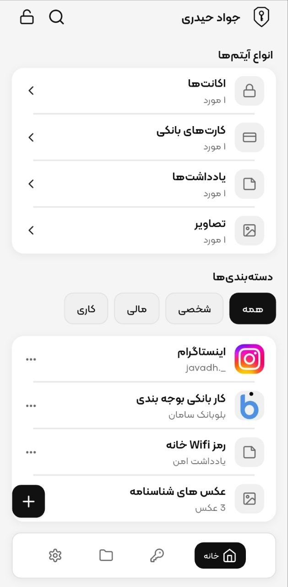
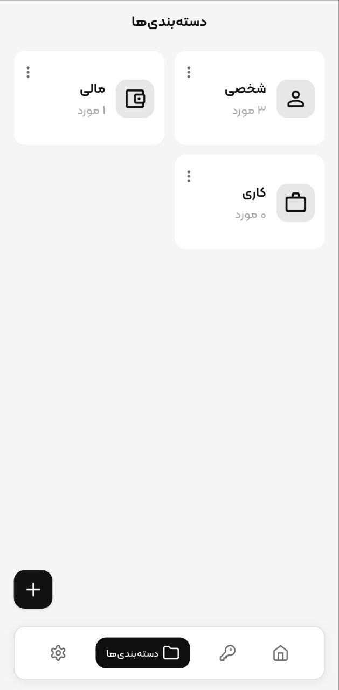
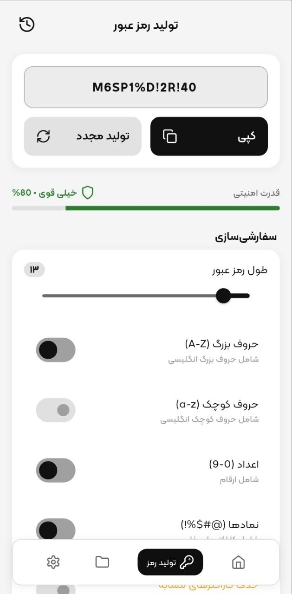
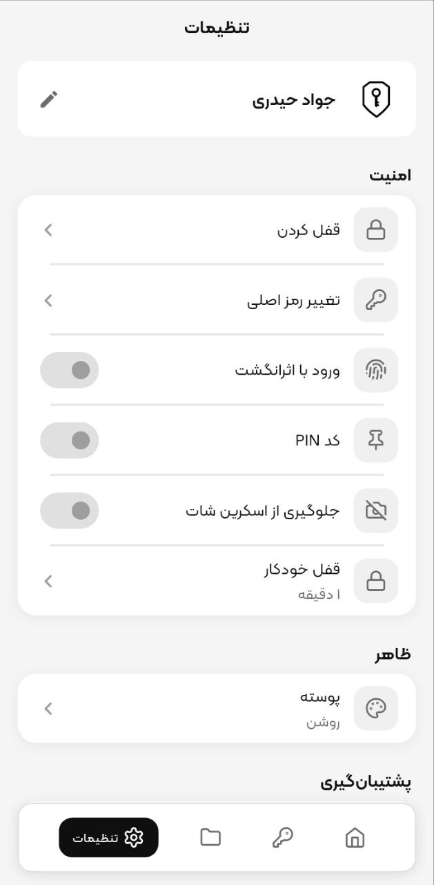
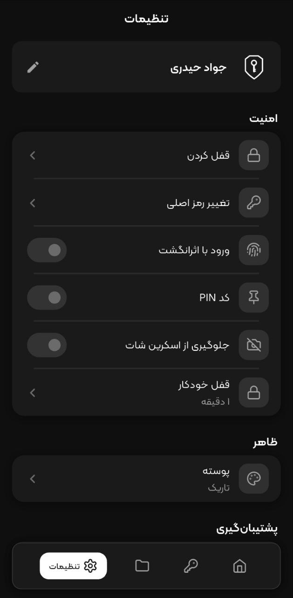
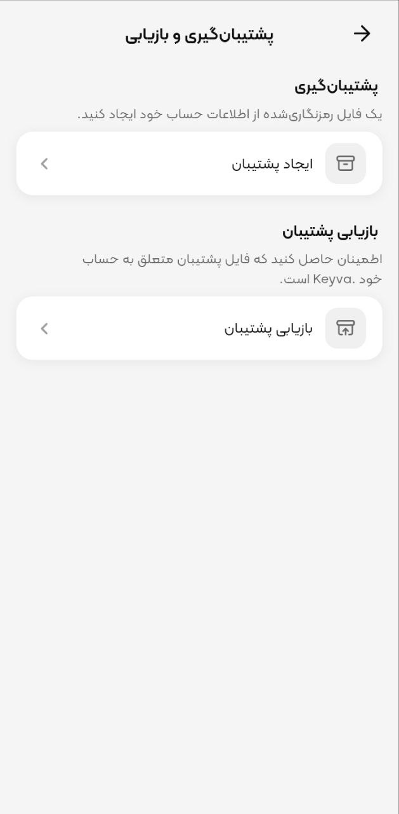

# Keyva

A privacy-first, offline password and secure information vault built with Flutter.

## Overview

Keyva is a local-only secure vault for everyday Android users who want to keep passwords, bank cards, notes, and private photos on their own device.

It does not use a backend, cloud account, or online login. Vault data stays on the device, is encrypted before it is stored, and can be used without an internet connection. Optional network access is used only for extras such as website favicons, store links, and contact channels.

The product goal is a simple, private vault rather than a synced cloud password manager.

## Screenshots

| Home | Categories |
| --- | --- |
|  |  |

| Password generator | Settings |
| --- | --- |
|  |  |

| Dark theme | Backup & restore |
| --- | --- |
|  |  |

## Features

- **Encrypted vault** for logins, bank cards, secure notes, and image folders
- **Master Password** as the primary credential (never stored)
- **Argon2id** key derivation and **AES-256-GCM** encryption
- **PIN** and **biometric** unlock on the same device
- **Auto lock** with a privacy overlay when the app is backgrounded
- **Android screenshot protection** (`FLAG_SECURE`)
- **Multi-account** support on one device
- Encrypted **backup and restore** (`.keyva` files)
- **Login records** (title, username, password, website, notes)
- **Bank cards** with Iranian bank detection
- **Secure notes**
- **Image folders** with camera/gallery capture; photo bytes stored as encrypted sidecar files; optional user-initiated save to the device gallery
- **Categories**, **search**, and **pinned items** (up to 5)
- **Password generator** with strength scoring and a 7-day local copy history
- Share login, card, or note text through the system share sheet (after confirmation)
- **Security settings**: change Master Password, PIN, biometrics, auto-lock timeout, screenshot protection, lock, and account deletion
- Persian **RTL** UI, Jalali dates, light / dark / system theme, onboarding, FAQ, and privacy policy

## Security

Keyva separates **who can unlock the app** from **how vault data is encrypted**.

**Authentication.** Unlock is local. The Master Password is never stored in plaintext or ciphertext. A PIN is never stored as plaintext. Biometric templates stay in the OS; Keyva only receives a success/failure result from `local_auth`.

**Key derivation.** A per-account random salt and Argon2id (64 MiB memory, 3 iterations, parallelism 4, 32-byte output) produce a derived key from the Master Password. That derived key is not the Vault Key.

**Vault key management.** Each account has a random 32-byte Vault Key. The Vault Key is wrapped with the derived key using AES-256-GCM and persisted as wrapped material. Changing the Master Password re-wraps the same Vault Key; vault ciphertext is not re-encrypted. PIN unlock derives a wrapping key from the PIN and unwraps the same Vault Key. Biometric unlock stores a random wrap key in platform secure storage (`flutter_secure_storage`).

**Encryption.** Vault JSON (logins, cards, notes, image metadata) is encrypted with AES-256-GCM (12-byte nonce, 16-byte tag) and stored in Hive CE. Image bytes live in app-private files under `vault_blobs/`, also AES-256-GCM encrypted with the session Vault Key.

**Session.** After unlock, the Vault Key is held in memory only. Locking or logging out zeros the key. Failed PIN/biometric attempts are limited (3 failures, then a 15-minute lockout). Crypto and auth failures fail closed.

**Backups.** A `.keyva` file is encrypted with a user-chosen backup password (Argon2id + AES-GCM), independent of the Master Password. Image blobs are included. There is no server-side recovery.

**Storage protection.** Hive holds user metadata, wrapped keys, and vault ciphertext. PIN/biometric wrap material uses encrypted SharedPreferences on Android. Screenshot blocking is implemented on Android only.

## Tech Stack

| Technology                | Purpose                             |
| ------------------------- | ----------------------------------- |
| Flutter 3.32+ / Dart 3.8+ | Mobile application                  |
| MVVM + feature folders    | Application architecture            |
| GetX                      | UI state and navigation             |
| GetIt                     | Dependency injection                |
| Hive CE                   | Local database                      |
| `cryptography`            | Argon2id and AES-256-GCM            |
| `flutter_secure_storage`  | PIN / biometric wrap material       |
| `local_auth`              | Device biometrics                   |
| `Result<T>`               | Explicit success / failure handling |

Other packages used in the implementation include `file_picker`, `image_picker`, `gal`, `path_provider`, `share_plus`, `permission_handler`, `shared_preferences`, `iranian_banks`, `shamsi_date`, and `cached_network_image_plus`.

## Architecture

Keyva uses **MVVM** with a **repository / data-source** local layer. There is no Domain, UseCase, or DTO-mapper layer.

Views talk to GetX ViewModels. ViewModels call services (when the feature has one) or repositories. Repositories and security services talk to Hive data sources, secure storage, or encrypted blob files. GetIt owns long-lived dependencies; GetX bindings own screen-scoped ViewModels.

```text
View (GetX)
    ↓
ViewModel
    ↓
Service (when present)
    ↓
Repository
    ↓
Data source
    ↓
Hive CE / flutter_secure_storage / encrypted blob files
```

Security primitives live in `lib/core/crypto` and `lib/core/security`. Session and auto-lock live in `lib/core/session`. Vault CRUD, unlock, and image blobs live under `lib/feature/vault`.

## Project Structure

```text
lib/
├── core/
│   ├── crypto/          # Argon2id, AES-GCM, key wrapping
│   ├── database/        # Hive CE boxes and adapters
│   ├── di/              # GetIt registration
│   ├── exceptions/      # Result<T> and typed failures
│   ├── routes/          # GetX routes and session guard
│   ├── security/        # PIN, biometrics, lockout, screen protection
│   ├── session/         # In-memory session and auto-lock
│   ├── store/           # Cafe Bazaar / Myket store links
│   └── theme/           # Design system
├── feature/
│   ├── auth/
│   ├── backup/
│   ├── category/
│   ├── home/
│   ├── onboarding/
│   ├── password_generator/
│   ├── search/
│   ├── settings/
│   ├── shell/
│   ├── splash/
│   ├── type/            # login, bank_card, note, image
│   └── vault/
├── shared/              # Reusable widgets and icons
└── main.dart
```

## Getting Started

### Requirements

- Flutter SDK **≥ 3.32.0**
- Dart SDK **≥ 3.8.1** (see `pubspec.yaml`)
- An Android device or emulator (primary target)

The repository also contains a standard iOS Flutter runner (camera, photo library pick/add, and Face ID usage strings are present). Android product flavors and screenshot protection are Android-specific.

### Installation

```bash
git clone https://github.com/javadHeidary/keyva.git
cd keyva
flutter pub get
```

No backend, API keys, or environment files are required. Hive adapters and FlutterGen outputs are already in the repository.

If you change Hive models, regenerate adapters:

```bash
dart run build_runner build --delete-conflicting-outputs
```

### Run

Android builds use store flavors (`bazaar` is the default):

```bash
flutter run --flavor bazaar --dart-define=STORE=bazaar
```

Myket:

```bash
flutter run --flavor myket --dart-define=STORE=myket
```

`STORE` only affects in-app store links (rate, share, other apps). Vault behavior does not depend on it.

## Testing

The project has **unit tests** and **widget tests** under `test/` covering cryptography, key wrapping, Hive storage, auth, vault operations, backup/restore, PIN/biometrics, auto-lock, settings, and several UI flows.

There is **no** `integration_test/` suite. Coverage is broad on core security and vault paths, but not complete for every screen.

```bash
flutter test
```

`dart_test.yaml` runs tests with `concurrency: 1`.

## Security & Privacy Notes

- Keyva is a **local/offline** vault. It does not provide cloud backup, account recovery, or remote unlock.
- You are responsible for protecting the Master Password, PIN, device lock, and any `.keyva` backup files.
- If the Master Password (and any backup password) is lost, encrypted vault data cannot be recovered by the app.
- Password-generator copy history is stored locally for 7 days and is separate from the encrypted vault.
- No system is absolutely secure. Keyva reduces exposure by keeping data on-device and encrypting it at rest; it does not make the device itself uncompromisable.

## Project Status

The current codebase is a **functional** local vault: account lifecycle, encryption, vault item types, backup/restore, and security settings are implemented and covered by tests.

This repository is intended as a **portfolio / open-source** Flutter project. The Android application ID is `com.keyva.app`. It should not be treated as a production-hardened, audited product.

## License

No license has been specified for this repository.

## Author

**Javad Heidary**
- Email: [javadheidary.dev@gmail.com](mailto:javadheidary.dev@gmail.com)

